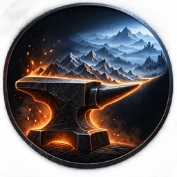

<p align="center"></p>

# AnvilLOD

A fast, incremental object-LOD generator for Skyrim SE/AE, built as a modern replacement for DynDOLOD.

Its goals:

- **Fast builds.** Plugins are parsed once, BSAs are indexed once, quads are processed in parallel, and textures go through the GPU.
- **Incremental re-runs.** Every LOD block has a fingerprint, so changing one mod rebuilds only the blocks it touches.
- **Better in-game performance.** Fewer draw calls through merged, atlas-aware blocks.
- **PBR-aware LOD.** Distant terrain and objects should match True PBR / Community Shaders surfaces.

## Downloads

Each release has two downloads:

- **AnvilLOD-&lt;version&gt;.zip**: the tool (desktop app + command line). Unzip anywhere and run `AnvilLOD.App.exe`; it is not a mod and doesn't go in MO2.
- **AnvilLOD SKSE Plugin-&lt;version&gt;.zip**: a FOMOD to install with MO2 or Vortex. It asks for your game version and installs the matching DLL: **SE 1.5.97 up to AE 1.6.1170**, or **newer than 1.6.1170** (1.7.99, 1.7.104 and later).

Maintainers build both with `.\package.ps1` (output in `release\`).

## Status

AnvilLOD scans the load order and writes object LOD blocks (`.bto`), billboard tree LOD (`.lst`, `.btt` and the tree atlas) and grass LOD (from the grass cache) for every worldspace with LOD settings. Walled cities (Whiterun, Solitude, Windhelm, Riften, Markarth) are copied from their child worldspaces into Tamriel's LOD, following DynDOLOD's child world configs. Dynamic LOD for quest-switched references, water planes, waterfalls and other DynDOLOD grid objects come from the SKSE plugin; Seasons of Skyrim LOD is supported (object LOD and grass LOD). **Pre-release:** feedback and bug reports are very welcome. Re-runs only rewrite what changed. Object texture atlasing and large references are still to come. See [docs/ROADMAP.md](docs/ROADMAP.md).

## Requirements

- .NET 10 SDK (Visual Studio 2026, or VS 2022 17.14+ with the .NET 10 SDK installed)
- Skyrim SE/AE (Mod Organizer 2 instance or a plain Data folder)
- **Recommended:** DynDOLOD Resources SE and any LOD packs / LOD patches you like (FOLIP, mod-specific LOD). AnvilLOD uses their `_lod` meshes and the `DynDOLOD_SSE_*.ini` rule files they ship.
- **For tree LOD:** tree billboards, e.g. TexGen output installed as a mod (`textures\terrain\LODGen\…`). TexGen is only a billboard renderer; DynDOLOD itself is never run. Trees TexGen has not seen can be drawn by AnvilLOD itself: see [Tree billboards without TexGen](#tree-billboards-without-texgen-opt-in).
- **For grass LOD:** a grass cache (`grass\*.cgid` from NGIO or FasterNGIO) and TexGen grass billboards. For seasonal grass LOD also the seasonal caches (`...WIN.cgid`, `.SPR`, `.SUM`, `.AUT`, from Grass Cache Helper NG). Set `DynDOLOD-Grass-Mode = 1` in NGIO's `GrassControl.ini` so the real grass ends exactly where the grass LOD starts; with it off there is a bare band between them.
- **Optional:** a DynDOLOD install (set "DynDOLOD folder" in the app or `--dyndolod`). AnvilLOD reuses its Low/Medium/High rule presets. DynDOLOD itself is never run.
- **Recommended in game:** [LOD Refresh Bug Fix](https://www.nexusmods.com/skyrimspecialedition/mods/187070) (`SkyrimLODFixes.dll`). It fixes engine bugs where LOD doesn't reset after fast travel or worldspace changes, and a tree LOD / grass culling lock bug. DynDOLOD DLL NG fixes the first of those too, so keep this one if you remove DynDOLOD DLL NG. AnvilLOD's SKSE plugin deliberately doesn't patch the same engine code, so the two don't conflict.

## Mod author tools

The **Missing LOD finder** (under "Mod author tools" on the left; or `AnvilLOD author --plugin "<file>" --author-out <folder>`) checks one plugin for objects and trees that are seen from afar but have no LOD: no LOD mesh, an MNAM path to a file that isn't there, LOD textures that are missing, models that are empty, trees with no billboard. It can then generate what's missing into its own folder (never into the LOD output):

- `meshes\lod\<plugin>\<model>_lod_0/1/2.nif`: the full model with small parts dropped and the rest simplified (quadric error, seams and borders kept), using the model's own textures.
- `textures\terrain\lodgen\<plugin>\<model>_<formid>.dds/_1.dds/_1_n.dds/.txt`: TexGen-style billboards rendered from the tree model.
- `DynDOLOD\DynDOLOD_SSE_<plugin>.ini`: rules for the generated meshes, in DynDOLOD's format, so they work with AnvilLOD and DynDOLOD.
- `AnvilLOD Author Report - <plugin>.txt`: every placed object and tree with its status and what was generated.

The tools are behind a confirmation: generated files are a starting point to check in NifSkope and in game, and are only shared with the mod author's permission. Files already in the output folder are kept unless "Overwrite" is ticked, so hand-edited ones survive a rerun.

- **All plugins (tree billboards)** is the first entry of the plugin list (`--plugin "*"` on the command line). It checks every tree in the load order that is placed in a worldspace with LOD and makes a billboard for each one that has none, into one folder. It looks where the scan looks (the folder of every plugin that overrides the tree, not just the one that defines it) and leaves out the small plants TexGen skipped on purpose (they show as "Skipped by TexGen on purpose").
- **Stand-in tree models** (`--tree-stand-ins`): some mods are released without every model their plugin names (Beyond Skyrim: Bruma and Assets name 30 tree models that are in no archive), so those trees are invisible and cannot get a billboard. This copies the closest existing tree model under the missing name, on your own PC, then makes the billboard. The model is chosen by name in the same folder (`treemaple04` falls back to the nearest-numbered `treemaple`); write pairs `meshes\missing.nif = meshes\existing.nif` in `AnvilLOD Tree Stand-ins.ini` in the output folder to choose it yourself. The copies are for your own use.

### LOD Mesh Maker

The **LOD Mesh Maker** (also under "Mod author tools" on the left; or `AnvilLOD lodmaker`) makes LOD meshes from full models you pick, with no plugin involved, for models that have no LOD mesh yet:

- **Models:** add `.nif` files, a mod folder, its `meshes` folder or any folder of models. It only reads the model files, so it needs no load order.
- **Output:** a **new mod in your MO2 mods folder** (give it a name; run it again with the same name to add more models) or any folder you choose. Never your LOD output folder.
- **What it writes:** `meshes\lod\<name>\<model>_lod_0/1/2.nif` (LOD4, LOD8, LOD16; pick the levels you want): small parts dropped, the rest simplified, the model's own textures kept. The files are written from the triangles alone, so collision and other game data from the full model are not copied. A **Detail** setting keeps more (finer) or less (coarser) of the model, and models below a size you set can be skipped.
- **Triangle budget** (on by default, optional): LOD meshes made from dense models can be far heavier than anything in a normal list, so each level is simplified until it fits a budget. **Recommended** scales with the model's largest dimension and comes from measuring the 2,554 LOD meshes in DynDOLOD Resources SE and LOD Model Library (the 90th percentile per size class, kept decreasing with distance): up to 1,000 units 250 / 200 / 150 triangles at LOD 0 / 1 / 2, 1,000-3,000 units 600 / 450 / 300, 3,000-8,000 units 2,500 / 1,500 / 650, over 8,000 units 1,400 / 900 / 600. **Custom** takes your own maximums per level (0 = no limit) and **Off** leaves only the Detail setting. A farther level never gets more triangles than a nearer one. If a budget can't be met (every part is already at its minimum) the file is still written and the report says it is over budget. Command line: `--budget recommended|off|<LOD0,LOD1,LOD2>`. The Mod Author tab and `author` command use the same budget for the LOD meshes they generate (a checkbox, `--budget`).
- **Rule file:** `DynDOLOD\DynDOLOD_SSE_<name>.ini` in DynDOLOD's format, so AnvilLOD and DynDOLOD use the new meshes for the models they were made from. Run it again and the file only gains lines for new models. Existing LOD files are kept unless "Overwrite" is ticked.
- Two models with the same file name can't both get LOD (LOD files are matched by name): the first, in path order, is made and the other is reported. Files that already are LOD meshes are skipped.
- Command line: `AnvilLOD lodmaker --input <file|folder> [--input ...] --output <folder>` or `--mo2 <instance> --new-mod <name>`, with `--levels 0,1,2`, `--detail <0.1-10>`, `--min-size <units>`, `--group`, `--no-rules`, `--overwrite`.

As with the other author tools, the generated files are a starting point to check in NifSkope and in game, and are only shared with the model author's permission.

### Texture fixer

Some textures are saved in a format Skyrim SE cannot load, usually **BC6H** (an HDR format, DXGI 95/96): the game then crashes the moment a shader uses one, often far from where the file is. The **Texture fixer** (under "Mod author tools" on the left; or `AnvilLOD fix-textures`) finds them and converts them to **BC7** with the same size and mip levels:

- **What it checks:** the mod folders you add, or every enabled mod of your MO2 profile and Overwrite ("All enabled mods"). It only reads the 148-byte header of each `.dds`, so 20,000 textures take about a second. Loose files only, not the inside of BSAs.
- **What it converts:** BC6H. Other formats the game cannot load are listed but not converted.
- **Where the result goes:** a **new mod in your MO2 mods folder** (put it above the broken ones, the originals stay untouched), a folder you choose, or **in place**, where every original is first copied to a backup folder (`%APPDATA%\AnvilLOD\texture-backups\<date>`) and a file that fails to convert is left alone.
- **texconv:** the conversion runs Microsoft's `texconv.exe`, found in the xLODGen, DynDOLOD or SSEEdit `Edit Scripts` folder (or choose it). Nothing is installed or bundled.
- Command line: `AnvilLOD fix-textures --input <folder> [--input ...]` (or `--mo2 <instance> [--profile <name>]`) only lists; add `--apply` with `--output <folder>`, or `--in-place --backup <folder>`, to convert; `--texconv <exe or folder>` to name texconv.

## Build

```powershell
cd path\to\AnvilLOD
dotnet restore
dotnet build -c Release
dotnet test
```

## Run the scan

**MO2 users (recommended):** when AnvilLOD is started from MO2 it opens on the profile MO2 has selected, not the one remembered from the last run. Point AnvilLOD at your MO2 instance folder. It reads the profile's modlist, plugins and load order and layers the mod folders itself, the way MO2's VFS would. There's no need to launch it through MO2.

**Folders on different drives, or a wrong auto-detect:** AnvilLOD reads the game folder, mods, profiles and overwrite folders from the instance's `ModOrganizer.ini`. Open **Locations** under the instance folder (or use `--mo2-game`, `--mo2-mods`, `--mo2-profiles`, `--mo2-overwrite`) and type any of them to override what the ini says; a box you leave empty keeps the auto-detect. The game folder can be given as the folder with `SkyrimSE.exe` or as its `Data` folder. With the game, mods and profiles folders typed, `ModOrganizer.ini` isn't needed at all (name the profile with the Profile box or `--profile`).

```powershell
AnvilLOD.exe scan --mo2 "D:\Modlists\MyList" --worldspace Tamriel
AnvilLOD.exe scan --mo2 "D:\Modlists\MyList" --profile "Default" --worldspace Tamriel --report tamriel.json
```

Write the LOD files with `generate` (same options plus `--output`):

```powershell
AnvilLOD.exe generate --mo2 "D:\Modlists\MyList" --worldspace Tamriel --output "D:\Modlists\MyList\mods\AnvilLOD Output"
```

Then enable that mod in MO2 and put it below other LOD outputs.

**Plain install:**

```powershell
AnvilLOD.exe scan --data "D:\Skyrim\Data" --plugins "%LOCALAPPDATA%\Skyrim Special Edition\plugins.txt" --worldspace Tamriel
```

The console prints timings for each stage plus block counts per LOD level. The JSON report lists every block, its reference count and hash, and any LOD meshes that MNAM points to but that don't exist.

## SKSE plugin (dynamic LOD)

References that quests switch on and off (Helgen Reborn's destroyed and rebuilt town, for example) can't live in the static LOD blocks. AnvilLOD writes them to `SKSE\Plugins\AnvilLOD\AnvilLOD.dyn` instead, and the AnvilLOD SKSE plugin draws their LOD only while they're enabled.

### Grass LOD

Grass LOD is built from the grass cache into the LOD4 blocks (sparser and larger at LOD8 and LOD16). The ground is cut into bins and every bin that has grass keeps one tuft, placed where that bin's grass is, as wide as the grass there covers, so coverage is even, follows the real grass and never leaves the blocky patches random sampling does. All grass types share one atlas texture (`textures\anvillod\grass\atlas.dds` and `atlas_n.dds`), so a block needs one grass material instead of one per grass type.

- **Density** (`--grass-density <pct>`, 1-100): the share of the cached grass kept. Measured on a 120-plugin Tamriel, objects LOD only, one season: 4% = 15M triangles / 0.7 GB, 8% = 20M / 1.1 GB, 15% = 29M / 1.7 GB, 25% = 43M / 2.7 GB, 40% = 60M / 3.9 GB, 60% = 92M / 6.1 GB, 100% (every blade) = 162M / 11 GB. The default is 8%.
- **Brightness** (`--grass-top`, `--grass-bottom`): how bright the top of a tuft and its roots are, like DynDOLOD's `GrassBrightnessTop` and `GrassBrightnessBottom` (default 85% and 50%). The object LOD brightness is applied on top.
- **Seasons:** with Seasons of Skyrim LOD ticked, each season's LOD4 blocks are built from that season's grass cache. Seasonal caches differ a lot (summer's can be several times denser than winter's), so the seasonal output is a multiple of the single-season sizes above.

### Water and animated distant objects

DynDOLOD's rules mark some objects with a Grid ("Near LOD", "Far LOD", "Far Full", "Never Fade LOD") and no LOD meshes: water planes, mineral pools, streams, waterfalls, creeks and rapids, fires, windmills, water wheels, ships. They get no static LOD; AnvilLOD hands them to the SKSE plugin, which draws them beyond the loaded cells ("Near LOD" ones up to `fNearGridDistance`, the others up to `fFarGridDistance`) as static models. Keeping them animated is an **experimental** opt-in (`bAnimateExperimental=1`, or the menu) because it can crash. When a mod ships DynDOLOD dynamic LOD meshes (`meshes\dyndolod\lod\<model path>_dyndolod_lod.nif`, as CS Water Mod and DynDOLOD Resources do) those are used; otherwise the full model. Rule files from mods (BIRDS, animated ships, natural waterfalls…) add their own grid objects the same way. Lake and sea water that's part of the landscape comes from terrain LOD (xLODGen), not from here. Turn it off with "Water and animated distant objects" in the app or `--no-grid-objects`.

**Stream, creek and pond water stand-ins** (`--water-standins`, a checkbox in the app, off by default). The water planes of streams, creeks and ponds (the `Water1024`, `Water2048` family and the tundra stream pieces) use a real water shader. Drawn by the SKSE plugin beyond the loaded cells, that shader is outside the engine's water system and comes out black. With the option on, Generate writes a copy of each such mesh into the output (`meshes\anvillod\water`) whose water uses a lit, semi-transparent "fake water" material (the technique CS Water Mod's own stream twins use) and points `AnvilLOD.dyn` at the copy. The original meshes and the mods that ship them are not touched. Sea and big lakes are terrain LOD (xLODGen) and are not affected. Needs "Water and animated distant objects" ticked.

Build it with Visual Studio 2026 (bundled vcpkg):

```powershell
cd path\to\AnvilLOD\skse
.\build.ps1 -Dest "D:\Modlists\MyList\mods\AnvilLOD"          # SE 1.5.97 / AE 1.6.x (default)
.\build.ps1 -Line 17                                            # newer than 1.6.1170 -> skse\dist\1.7.x
.\build.ps1 -Line both -Dest "D:\Modlists\MyList\mods\AnvilLOD" # both into skse\dist, line 1 into Dest
```

There are two build lines from the same source: SE 1.5.97 up to AE 1.6.1170, and everything newer. Skyrim 1.7.99/1.7.104 ship Address Library in a new file format that the CommonLibSSE-NG used for SE/AE can't read, so 1.7.x gets its own DLL built on CommonLibSSE-NG 7.2.0 (alandtse, `ng` branch; `cmake\manifest-17`, `cmake\ports-17`). Each DLL refuses to load on the other game version. CommonLibSSE-NG 7.2.0 is GPL-3.0-or-later (with a modding exception), so the 1.7 DLL has to be shared under GPL-compatible terms with its source.

With SKSE Menu Framework (or ApocryphaRealm Menu Framework, which answers to the same name) installed, AnvilLOD adds four pages to its menu: **Distances & Grass** (live sliders for the LOD block and tree distances, the full-model fade multipliers and the real-grass fade distances, saved to `AnvilLOD.ini`; the LOD ones are the same settings DynDOLOD's MCM offers), **Dynamic LOD** (on/off, range, cap, live counts), **Water & Animated Objects** (on/off, water-shader planes, near/far distances, animation rate) and **About** (build line, game version, related DLLs). Without a menu framework the same settings live in `AnvilLOD.ini`.

**Single install:** Generate also puts the matching `AnvilLOD.dll` into the output (`SKSE\Plugins`), so the LOD output mod is all you need. "SKSE plugin" in the app (`--skse-dll` in the CLI) is auto-detect by default (reads `SkyrimSE.exe`'s version next to the game's Data folder), or pick the build yourself, or "Installed separately" if you use the FOMOD instead — never both. The tool carries both builds in its `SKSE\` folder; `build.ps1` bundles whatever `skse\build.ps1` has built.

Settings are in `SKSE\Plugins\AnvilLOD.ini` (written with defaults on the first Generate); the log is `Documents\My Games\Skyrim Special Edition\SKSE\AnvilLOD.log`. Turn the feature off with "Dynamic LOD" in the app or `--no-dynamic`.

The plugin also applies the LOD distance settings (`fBlockLevel0Distance`, `fBlockLevel1Distance`, `fBlockMaximumDistance`, `fSplitDistanceMult`, `fTreeLoadDistance`, `fSkyCellRefFadeDistance`) the way DynDOLOD DLL NG does. It reads DynDOLOD's MCM files (`MCM\Config\DynDOLOD\settings.ini`, `MCM\Settings\DynDOLOD.ini`), so the values you saved there carry over, and the `[LOD]` section of `AnvilLOD.ini` overrides them. Save either file while the game runs and the change is applied within a couple of seconds. While DynDOLOD.dll is still installed it is left in charge (`bOverrideDynDOLOD=1` to take over).

### DynDOLOD rule compatibility

Rule files written for DynDOLOD are used as they are: DynDOLOD's own `Rules` folder, `Data\DynDOLOD\DynDOLOD_*.ini` from mods, and rule files a mod left in the Data root. Both 7- and 9-column lines, `Level0`/`Static LOD4`/`Full model`/`None` choices, FormIDs written with a load order prefix (`Mod.esp;0600187D`), `[… Settings] IgnoreWorlds=`, `Configs\DynDOLOD_SSE_mod_world_ignore.txt`, `mesh_lookup.txt`, child world configs and ChildworldMatches. the Grid column (water and animated objects, above). Not yet: the Reference column (`Replace`/`Enable`), `.patch` files, `IgnoreParentWorlds`.

### Editing the LOD rules

DynDOLOD's Advanced window lets you pick Low, Medium or High, tick **Candles** and **FXGlow**, and edit the Mesh and Reference rules list. AnvilLOD has the same, kept out of the way in the **LOD RULES** section of the settings column:

- **Candles / FXGlow** (`--candles`, `--fxglow`; need the DynDOLOD folder): also load DynDOLOD's `DynDOLOD_SSE_candles_*.ini` and `DynDOLOD_SSE_fxglow_*.ini` for the chosen preset. Candles, lanterns, sconces and the glow cards of fires get Far LOD, so the SKSE plugin draws them beyond the loaded cells. (The `candles_all` file holds the switched-off variants and is read before the lit ones, as DynDOLOD does.) In a Solstheim scan, ticking both added 121 rules and 102 more dynamic LOD references. Whether the lights show up well in game has not been checked yet.
- **Edit rules…** (next to the preset drop-down): opens the rule list for the chosen preset (plus Candles / FXGlow if ticked): mesh mask or reference, LOD 4 / 8 / 16 / 32, flags, grid, reference and which file it comes from, in the order they apply. Double-click a row, or press Edit, for the same editor DynDOLOD has (VWD, NoGlow, NoMATO, Dynamic, TREE; LOD levels with Level0-2, Billboard1-6, Full model, None; Grid; Reference). **Add rule…** makes a new one, **Find** filters the list. Editing one of DynDOLOD's rules makes your own copy (orange) that wins over the original; **Remove my rule** brings the original back. The rules for the DBF-style tree setup, for example, are the `tree` rule (LOD4 Level0, LOD8 Billboard4, LOD16 Billboard4, LOD32 Billboard6) and the `\` rule's LOD32.
- **Custom rules file:** your rules are saved as a DynDOLOD-format rule file (`%APPDATA%\AnvilLOD\Rules` by default) and its **tick box** switches it on. You can also point it at a file you already have, for example a rule file or preset from a modlist. Its rules are read before all of DynDOLOD's own, so they win; its `\` catch-all rule replaces the preset's. With the tick off, only DynDOLOD's own rule files are used. `--rules <file>` does the same on the command line.
- Only the rules of the preset files are listed; the rule files of individual plugins (FOLIP, mod patches and so on) are still read as before, below your own rules.
- The **NoGlow** flag and the **Reference** column are stored and saved but AnvilLOD doesn't act on them yet. Window glow in the LOD still comes from the glow maps of the LOD models themselves.
- Each of the three preset tabs remembers its own Candles / FXGlow / custom rules choices.

## Seasons of Skyrim

Grass LOD follows the season too when the grass cache has seasonal files (see Grass LOD above).

With "Seasons of Skyrim LOD" ticked (`--seasons`), Generate reads the form-swap INIs in `Data\Seasons` (`*_WIN.ini`, `_SPR`, `_SUM`, `_AUT`; sections Statics, MovableStatics, Activators, Furniture) and writes seasonal object LOD next to the normal blocks: `<World>.<L>.<X>.<Y>.WIN.bto` and so on, the names [Seasons of Skyrim](https://github.com/powerof3/SeasonsOfSkyrim) loads for that season. Blocks containing a swapped object are rebuilt with the swap's LOD; every other block is a hard link to the normal one, so it costs almost no disk space. Seasons without INIs get no files, and Seasons of Skyrim falls back to the normal LOD. Tree and terrain LOD are the same in every season for now.

## Brightness

## 3D tree LOD (opt-in)

Tick **3D tree LOD** (`--tree-3d`) to put real 3D trees into object LOD, the way DynDOLOD's "ultra tree LOD" does. A tree uses a 3D tree LOD model, a `<tree>_<CRC32>passthru_lod.nif` in `meshes\DynDOLOD\lod\trees`, when one matches. The CRC32 is the checksum of the tree's own mesh file, so a model is only used for the exact mesh it was made for. Resource packs such as DynDOLOD Resources and Happy Little Trees' 3D LOD add-on ship them.

- Trees with a model get the 3D model at LOD4 and billboard cards at LOD8, LOD16 and LOD32 (`--tree-3d-lod8` uses the model at LOD8 too, with much bigger files). They are taken out of the billboard tree LOD (`.btt`); every other tree keeps billboard tree LOD.
- Models are read with their shaders untouched ("passthru"). `spherenormals` shapes get normals pointing away from the model's centre, and the **tree LOD brightness** setting applies to the 3D models and the cards alike.
- **Accept models by tree name** (on by default; `--tree-3d-crc-only` turns it off): when no model has the tree mesh's CRC32 in its name, the model stored under the plain tree name is used. That is how DynDOLOD Resources ships almost all of its models and how DynDOLOD itself matches (a CRC32 in the name is only for name collisions). A model made for another version of a tree mesh (before a mod or a patcher changed it) can look slightly off; with the option off you get exact matches only, which is none with DynDOLOD Resources. The log says how many tree types are matched by name.
- A model whose textures can't be found isn't used, and the trees keep billboard tree LOD. The usual cause is the flat trunk textures (`textures\DynDOLOD\LOD\Trees\<tree>_<CRC32>_trunk_1.dds`), which TexGen renders from the model's `_trunk.nif` in `DynDOLOD\Render\Billboards`. Run TexGen with that resource installed, or use a pack that ships the textures.
- The log estimates how many triangles and megabytes the models add to the blocks before you generate. 3D trees can make LOD4 files much larger (about 40 KB per tree in a real list).

Tree LOD and object LOD brightness go from 10% to 110% in 10% steps (`--tree-brightness`, `--object-brightness`). Object LOD is darkened through vertex colours, so the LOD textures themselves, which other mods share, are never changed.

## PBR textures in object LOD (opt-in)

LOD is drawn with vanilla shaders, which don't do PBR. A LOD mesh that uses a texture your PBR mods replace (`textures\pbr\<same path>`) shows the vanilla look while the real object shows the PBR one, so mountains and buildings don't match their LOD. Tick **Match PBR textures in object LOD** (`--pbr-lod`) and AnvilLOD handles it the way DynDOLOD does:

- A LOD texture that TexGen has made a PBR twin of (`textures\lod\<name>lod.dds` → `<name>pbr_lod.dds`, with its `_n`) uses the twin. Run TexGen first; AnvilLOD reads its output like any other mod.
- Any other texture that has a PBR version gets a converted copy of the PBR albedo in `textures\anvillod\pbr\...`, and the LOD points at the copy. The vanilla path is never overwritten, so nothing else changes. Copies are shrunk (`--pbr-lod-size`, 512 by default) and written as BC7 with mips.
- The conversion darkens the PBR colours (a gentle power curve and DynDOLOD's default PBR scale of 0.65) because the PBR albedo is meant for linear lighting. It is an approximation fitted to TexGen's own output, so tune **PBR LOD texture brightness** (`--pbr-lod-brightness`, 100 = default) in game: lower it if the LOD looks brighter than the real objects. Changing the option or the brightness rebuilds every block.
- Tree LOD (billboards and 3D models) isn't covered yet.

## Ships

Moored ships in object LOD (LOD4 and LOD8) are made from the real ship models you have installed, simplified to a triangle budget that grows with the ship's size, instead of the very coarse stock LOD meshes (a longboat is about 250 triangles there, 2,800 here). **Detailed ships** is on by default (`--no-detailed-ships` turns it off). Nothing is shipped with the tool: the meshes are made on your machine, so a ship replacer and replacer textures follow into LOD automatically.

- Rigging, sails and masts stay; the shield rows and other decoration go first when a ship is over budget. A paint overlay and a floor copy that sit exactly on another surface are lifted a little so they do not fight it, and the LOD is sunk 3 units into its own surface so the real, bumpier deck wins where both are drawn.
- It recognises ships from the base game (`meshes\dungeons\ship\`) and from Ships and Boats of Tamriel and the mods built on it (`meshes\bstamriel\dungeons\ships\`: Red Wave Corsairs, DK's Realistic Nord Ships, Solitude Dock Additions, ...), and models PGPatcher redirects to `meshes\_pgpatcher_dups\`. Interior pieces and anything under 600 units long are not taken for ships.
- A ship with no LOD at all (a mod added it without LOD files) gets one made from its model when the DynDOLOD rules ask for LOD for it. The log lists them: `Detailed ships: N ship models drawn from their real models (...)`.
- Run PGPatcher before Generate.

**Opaque LOD textures.** The engine's LOD shader alpha-tests a shape's diffuse alpha even when the shape has no alpha property, so a texture whose alpha channel holds something else (the vanilla ship hull keeps gloss there) came out full of holes. Generate points such shapes at opaque copies under `textures\anvillod\opaque\`; your own textures are never changed.

## Animated Ships

With Vicn's Animated Ships in the load order: its wrecks that only bob up and down get ship LOD built from their model (DynDOLOD's rule for the mod leaves them out of LOD), and its sailing ships are drawn beyond the loaded cells as real references in `AnvilLOD.esp`, which the engine animates; the SKSE plugin switches them on and off with the originals, so they follow the mod's own schedule. Needs the native waterfalls, windmills and water wheels option (`--native-grid-objects`). **Animated Ships** is on by default (`--no-animated-ships`); it does nothing without the mod.

## Community Shaders Grass Optimizations

With the Grass Optimizations feature installed, Generate writes `meshes\LOD\Grass\<model>_LOD0.nif` (middle distance) and `_LOD1.nif` (far) for your grass models, which the feature swaps in over distance. They are your installed grass models simplified (about half of the triangles for the middle tier, about a fifth, at most 64, for the far tier), keeping the model's own texture, UVs, normals and vertex colours, so nothing else changes and no grass mod's files are rewritten. A grass type with no file keeps its full mesh. Models that are already tiny, have several shapes, are in the old Skyrim LE format or have another vertex layout are left alone, as are tiers your grass mod ships itself. Turn on mesh LODs in the feature's settings in the Community Shaders menu. On by default; `--no-cs-grass` turns it off; does nothing when the feature is not installed.

AnvilLOD's own grass LOD (the grass in the LOD4 blocks) is unchanged. The feature's author recommends NGIO's extended grass distance plus these LOD meshes instead of grass in the blocks, so if you use extended grass, consider unticking **Grass LOD**.

## Presets

The three tabs above the options (top right of the options box) are presets. Each one remembers every setting: output folder, worldspaces, LOD levels, the DynDOLOD folder and rule preset, and all the options. Click a tab to switch (the column slides over to the new preset), double-click a tab to rename it. The preset you leave is saved first, and a preset that was never used starts as a copy of what is on screen, so switching never loses anything. Use them for, say, a fast test setup and a full release setup.

The game source (MO2 instance, Vortex or Data folder, the profile and the optional **Locations**) lives in the bar at the top of the window and is shared by all presets.

## Large references (opt-in)

Skyrim SE has a **large reference grid**: a list, per cell, in the worldspace record of an ESM-flagged plugin, of references whose full models the game shows beyond the normally loaded cells (`uLargeRefLODGridSize` in SkyrimPrefs.ini; 5 turns it off). Skyrim.esm and the DLCs list theirs. Tick **Large references** (`--large-refs`) and AnvilLOD lists the ones from your other ESM-flagged plugins that nobody lists yet, in `AnvilLOD.esm`, flagged ESL, so it takes no plugin slot.

- **Which references:** the base record is a STAT (or a MSTT with record flag 0x4), half the object bounds diagonal times the reference scale is more than `fLargeRefMinSize` (512 in Skyrim.esm), it is defined in ESM-flagged plugins only, it doesn't start disabled, and no plugin lists it yet. The size rule is not a guess: it reproduces the list Bethesda shipped. In Skyrim.esm's Tamriel every STAT reference whose full bounds diagonal times scale is at least 1,024 is listed, and almost none of the smaller ones.
- **What is left out, and why:** references that a plugin outside the ESMs overrides, and ones that start disabled, because those are the known causes of large references flickering (the full model and the LOD drawn in the same place). The report, `AnvilLOD Large References.txt` in the output folder, counts what was listed and what was left out and why, for every worldspace.
- **The plugin:** `AnvilLOD.esm` only holds one worldspace override per worldspace that got new entries, with the list entries (one per cell, the reference's own cell, as DynDOLOD does). Enable it after your other ESMs, so the worldspace data it is based on is current. Its masters are all ESM-flagged; AnvilLOD checks that every time and warns if one isn't. Turn the option off and the file is removed from the output.
- **ESL or a slot:** by default `AnvilLOD.esm` is flagged ESL, so it takes no plugin slot. If large references flicker at a distance and you want to rule the ESL flag out, untick **Flag AnvilLOD.esm as ESL** (`--large-refs-no-esl`) and generate again: it is then a normal ESM and uses one slot. Nothing in DynDOLOD's documentation says ESL causes flicker (it suggests an ESM+ESL plugin for this), so treat it as a troubleshooting step.
- **Cost:** full models loaded farther out cost performance, so the list is kept to what Bethesda's own rule would pick. The grid size (`uLargeRefLODGridSize`) decides how far they show.
- **Flicker:** AnvilLOD doesn't include the large reference bug workarounds. If you have DynDOLOD DLL NG installed, its Large Reference Bugs Workarounds are what DynDOLOD's documentation recommends for flicker, and it works alongside AnvilLOD's plugin (AnvilLOD leaves the LOD distance settings to it while it is installed). When AnvilLOD finds DynDOLOD DLL NG in your load order it says so in the log and the report; it doesn't recommend installing it.

## Texture matching

Object LOD textures follow the full model, the way DynDOLOD does: a base record's alternate textures (MODS, resolved through its texture sets) replace the LOD shape's diffuse and normal by shape name, so snow and ice variants and re-skinned rocks get matching LOD. Stitched `textures\lod` textures and textures that exist nowhere are left alone. On by default; `--no-match-textures` turns it off on the command line.

## Snow and ash on distant mountains

The game puts its snow and ash LOD shader on object LOD shapes by the shape's name in the `.bto` (`objSnow`, `objSnowHD`, `objAsh`, `objAshHD`). Like DynDOLOD, AnvilLOD names an object's shapes that way when its base record's Material has "snow" or "Ash" in its EditorID (for example `SnowMaterialMountain1P`), and uses the HD name for shapes that use full textures instead of LOD textures at LOD4 (DynDOLOD's default: the higher levels use only the plain snow material). Without it, mountains in LOD have no snow until the real model loads. Run Generate again to get it (existing LOD is rewritten once). Snow intensity (vertex alpha) and the Majestic Mountains `_lod_0l`/`_lod_0h` variants are not handled yet.

## Window glow (experimental)

DynDOLOD's resource packs ship glowing-window meshes next to the LOD meshes: `<model>glow_lod_N.nif` (`farmhouse05glow_lod_0.nif`, `castleexttower01glow_lod_1.nif`, ...). Tick **Window glow** (`--glow-windows`) and Generate adds every reference whose model has one to `AnvilLOD.dyn`; the SKSE plugin draws the glow mesh beyond the loaded cells and lights it by the game hour: dark by day, fading in from 18:00 to 20:30, full through the night, fading out from 4:30 to 6:30. The mesh's number picks the grid, as in DynDOLOD: `_0` the near grid, `_1` the far grid, `_2` never fades (distances: `fNearGridDistance`, `fFarGridDistance`).

- The meshes use the `External_Emittance` shader flag, which makes the engine take the glow from the reference's emittance region; a model the plugin attaches has none, so the plugin switches it to the mesh's own emissive and drives the multiple itself.
- `bGlowWindows`, `fGlowIntensity` (and `fGlowDuskStart`, `fGlowDuskEnd`, `fGlowDawnStart`, `fGlowDawnEnd`) are in `AnvilLOD.ini`; the in-game menu (Dynamic LOD page) has the switch and the intensity.
- Not yet: windows of forts and other objects DynDOLOD writes into the static LOD, and a darker glow in rain or fog (the hour is all it follows). Needs the glow meshes from DynDOLOD Resources (or another pack that ships them).

## Parent > Child copies (experimental)

The walled cities (Whiterun, Solitude, Windhelm, Riften, and Dragonsreach's porch) are worldspaces of their own that deliberately leave out the objects outside the walls, so the view over the wall is empty. DynDOLOD fixes it with its **Parent > Child** option: it copies Tamriel's trees, rocks, roads, fences and mountains around the city into the city's worldspace, about 20,000 references in a plugin. AnvilLOD does it without a plugin: tick **Parent > Child copies** (`--parent-copies`; needs `--dyndolod`, because the rules come from DynDOLOD's `childworld_*.ini` files) and Generate writes `SKSE\Plugins\AnvilLOD\AnvilLOD.copies`. The SKSE plugin draws each model while you are in that city's worldspace: anywhere in the cells the city worldspace owns (the engine hides Tamriel's LOD in all of them), and within the loaded cells elsewhere (beyond them Tamriel's LOD shows it). The same mechanism brings back what the engine hides there besides objects: **grass LOD** (one small mesh per cell, from the grass cache) and **river and pond water** (the city worldspaces switch the terrain LOD water off; a flat plane at the cell's own water height, using the water stand-ins' material, so turn those on too).

- **Which references:** the ones DynDOLOD copies: inside each city's `Bounds` grown by 5 cells (minus `BoundsIgnore`), with LOD (a LOD mesh or a tree billboard), not switchable (start disabled, enable parent, persistent), not on the `IgnoreParentEDID` list, not in a navmesh cell where `NoCellsWithNAVM=1`, and not one of the city stand-ins that DynDOLOD's `ChildworldMatches` list says the city already has the real object for (Tamriel's low-detail walls and houses). Flat ground pieces (road chunks and the like) are left out too: drawn as models they z-fight with the terrain and show as blurry patches. Checked against a real DynDOLOD run: 92% of its copies are found (the roads are most of the rest), 94% of ours are in its list, and inside the city bounds all but a handful are.
- **Where it draws:** by default only in cells the city worldspace has (where the engine hides Tamriel's LOD and the object is simply missing). **Also where the city worldspace has no cell** (`bParentCopyAllCells=1`, in the in-game menu too) draws them everywhere in the loaded cells, which may show a model on top of its own LOD.
- **Limits:** the copies are drawn models, not references: no collision, no activation, probably no shadows. Rock piles that swap textures (snow, moss, tundra variants) show the model's default textures; the log counts them. Off by default.
- `bParentCopies=0` in `AnvilLOD.ini` turns the drawing off without regenerating.
- **Real grass around the walls (`bCityGrass=1`, on by default).** Whiterun's worldspace switches the real grass off (NoGrass) but uses the parent's terrain, so the cells the game keeps loaded around you showed bare dirt in a square that followed you. The plugin clears that flag in memory when the game starts (nothing is written to disk; it needs a restart, and the menu has a checkbox).
- Every object the plugin draws starts fully opaque. The engine fades a model's root node by the distance to the camera, using settings its own reference loading sets up; a clone attached by the plugin never gets them and used to start at zero, so the copies were invisible inside the square around the player and appeared as you walked away.

## Terrain underside (opt-in)

Volumetric lighting mods (DVLaSS, EVLaS, Community Shaders' sky sync) need a low-resolution copy of the terrain facing downward under the world, or sun rays and shadows leak through the landscape. DynDOLOD makes it ("Terrain underside"); tick **Terrain underside** (`--underside`) and AnvilLOD does too, for every worldspace that has LOD32 blocks, including ones added by mods.

- `meshes\Terrain\<worldspace>\<worldspace>_Underside.nif`: one shape per LOD32 block, built from the winning LAND heights. Each vertex is the lowest LAND height within one step around it, so the mesh stays at or below the terrain everywhere and can't poke through. Neighbouring blocks agree along their shared edge. `--underside-detail <4|8|16|32|64|128>` sets the LAND vertices per underside square (default 16: about 90,000 triangles and 1.5 MB for Tamriel; smaller is finer and heavier).
- `AnvilLOD.esp`, flagged ESL, so it takes no plugin slot. It holds one moveable static per worldspace and places it: a persistent reference 500 units below the world, in each worldspace's own persistent cell. Enable it in your mod manager. It needs the plugins that define the worldspaces as masters, and it overrides the worldspace and its persistent cell as they were when you generated, so load it after plugins that edit worldspaces and generate again when they change.
- Don't combine it with DynDOLOD's own underside (they would both place one). Child worldspaces of another one (Markarth, Sovngarde, Skuldafn, Hunter HQ, Falmer Valley, Deepwood Redoubt: they use the same cell coordinates as Tamriel) get no ESP reference, because a persistent underside reference in a child world was drawn in Tamriel as a translucent slab at Dragon Bridge. The SKSE plugin draws theirs instead, from `SKSE\Plugins\AnvilLOD\AnvilLOD.underside`, only while you are in that worldspace (`bUndersides=1` in the plugin INI). Worldspaces DynDOLOD ignores (Blackreach, Soul Cairn, Apocrypha, the Deadlands, Japhet's Folly, the Creation Club Qasmoke world) get none. Hidden quads and the Solstheim and Markarth trims DynDOLOD's INI can set are not applied.
- The plugin's copies of the worldspace and persistent cell are stripped of the winner's max-height table (MHDT), occlusion data (TVDT) and region list, like DynDOLOD's own overrides. Left in, a stale copy of those made the underside show through as a flat slab near Dragon Bridge (cells -27,19 and -29,20).
- Experimental: the placement is the same as DynDOLOD's except that the reference is enabled from the start instead of being switched on by a DynDOLOD script. The engine behaviour has not been checked in game yet.

## Vortex

Pick "Vortex" as the game source: Vortex deploys mods into the game's Data folder, so AnvilLOD reads it like a plain install with Vortex's load order. "Output to Vortex staging" sends the output to `%APPDATA%\Vortex\skyrimse\mods\AnvilLOD Output`; refresh Vortex, enable it and Deploy.

## Versions

`VERSION` holds the one version number the tool and the SKSE plugin share. `.\bump.ps1` raises the last number (0.2.0 → 0.2.1) after each change; `.\bump.ps1 -Minor` starts the next minor version. `.\package.ps1` builds everything and writes `release\AnvilLOD-<version>.zip` and `release\AnvilLOD SKSE Plugin-<version>.zip`.

## Output folder

Generate writes into the output folder you pick. Leave it empty and AnvilLOD uses **AnvilLOD Output**: a new mod folder in your MO2 mods folder (it appears after a refresh, ready to enable), Vortex's staging folder, or Documents. A folder that doesn't exist is created.

**Empty the output folder before generating** (on by default, `--keep-output` to turn it off) deletes what the last run left there, so old files (a plugin you no longer tick, blocks of a worldspace you left out, an old underside) never mix with the new ones. It is careful about what it deletes: it only empties a folder that is empty or that AnvilLOD wrote (it has `AnvilLOD.manifest.json` or `AnvilLOD.log`), never a folder that looks like a game, MO2 or mods folder (it holds `ModOrganizer.ini`, `SkyrimSE.exe`, `mods`, `Data` and so on) or a drive root. Any other folder is left alone and the log says why. MO2's `meta.ini` in a mod folder is kept. Files the game has open (a running game's `AnvilLOD.dll`) can't be deleted; the log lists them. Because the output starts empty, every block is written again on each run; untick the option to update in place, which only rewrites changed blocks.

## Desktop app

`src\AnvilLOD.App` is a WPF front end for the same pipeline. Choose **MO2 instance** (instance folder + profile) or **Data folder**, set the output folder, pick worldspaces, LOD levels and options, then press **Scan**. The window has one button per group of settings on the left (Output and worlds, LOD rules, Objects and terrain, Trees, Grass and size, Seasons / water / dynamic) and the two mod author tools under them. The results are in the upper box and the options of the chosen group in the lower one. Each results tab can be saved with **Print to file** (Overview and Log as text, Blocks and Missing meshes as CSV), and **Expand** makes the results box fill the window (Esc or Restore brings the options back). Results appear in four tabs: Overview (stats and timing), Blocks (filterable list of every `.bto` and whether it needs a rebuild), Missing meshes, and Log. Settings are saved to `%AppData%\AnvilLOD\settings.json`. **From MO2:** the app and the command line start from MO2's executables list like any other tool (add `AnvilLOD.App.exe` under Edit executables); the window title then says "running under MO2". It doesn't need MO2 to run, because it reads the instance's mods itself, but starting it from MO2 works too. If it ever fails to start from MO2, `%LocalAppData%\AnvilLOD\logspp.log` says how far it got. **Generate LOD** runs the scan and then writes the changed blocks into the output folder.

## Layout

| Project | Purpose | Depends on |
|---|---|---|
| `AnvilLOD.Core` | Grid math, `.lod` settings, reference model, quad bucketing, hashing, manifest, pipeline interfaces | nothing |
| `AnvilLOD.Plugins` | Mutagen: load order, MO2 instance reader, winning-override scan, fast BSA index, tree LOD, `ScanPipeline` | Core, Meshes, Textures, Mutagen |
| `AnvilLOD.Meshes` | Managed SSE NIF reader/writer, `.bto` builder, parallel generator | Core |
| `AnvilLOD.Textures` | DDS + BC1–BC7 decode, BC7 encode, tree atlas; GPU atlas/billboards later (milestone 2) | Core |
| `AnvilLOD.Cli` | Headless runner (`AnvilLOD.exe`) | Core, Plugins |
| `AnvilLOD.App` | WPF front end | Core, Plugins |
| `tests/AnvilLOD.Core.Tests` | xUnit tests for grid math, hashing, manifest | Core |

Package versions are pinned centrally in `Directory.Packages.props`.

## License

AnvilLOD is released under the **GNU General Public License, version 3** (GPL-3.0-only); see [LICENSE.txt](LICENSE.txt), which also lists the
third-party libraries and why GPL applies (Mutagen, GameFinder and CommonLibSSE-NG by alandtse are GPL-3.0 libraries).

    AnvilLOD
    Copyright (c) 2026 CageTV

    This program is free software: you can redistribute it and/or modify it under the terms of the GNU General Public License as published by
    the Free Software Foundation, version 3 of the License. This program is distributed in the hope that it will be useful, but WITHOUT ANY
    WARRANTY; without even the implied warranty of MERCHANTABILITY or FITNESS FOR A PARTICULAR PURPOSE. See the GNU General Public License for
    more details. You should have received a copy of the GNU General Public License along with this program. If not, see
    <https://www.gnu.org/licenses/>.

AnvilLOD contains no DynDOLOD code and ships no DynDOLOD assets. Like xLODGen, it reads whatever LOD meshes are installed in the user's own setup
(via MNAM), and the generated output must not be redistributed if it contains other mods' assets without their authors' permission.


## Quality layers (change the LOD quality in game)

Grass, 3D trees and tree cards are written into their own shapes in every LOD block, each under a node named for its layer and LOD level (`AL:grass:4`, `AL:tree3d:8`...). The AnvilLOD SKSE plugin finds them in the loaded LOD and can hide or show each one per LOD level, so you can generate at the quality your best case needs and lower it in game, like a graphics setting. Open **SKSE Menu Framework, AnvilLOD, Quality Layers**: presets Max, High, Medium and Low, or tick each layer and level yourself, and **Save to AnvilLOD.ini** to keep it (`[Layers]`, e.g. `bShow_grass_16=0`; the file is re-read while the game runs).

**Grass density in game.** The grass of every block is written in four density tiers, each in its own node (`AL:grass:4`, `AL:grass:4:1`, `AL:grass:4:2`, `AL:grass:4:3`; the first keeps the plain name). Every tier is every fourth tuft along a space-filling curve over the ground, so any first few of them are an even share of the grass, not bald squares. The **Grass density** slider on the Quality Layers page (`iGrassTiers` in `[Layers]`, 1 to 4) shows 25, 50, 75 or 100% of the grass you generated, in every grass LOD level. The presets use it: Max 100%, High 75%, Medium 50%, Low 25%, on top of what they already hide (Adaptive Quality steps through the same presets). So you can generate the full 100% density and let each player choose how much of it to draw. LOD generated before 0.2.63 has one tier, which is always drawn.

Hiding a layer saves drawing cost (triangles, overdraw, frame rate). The hidden data stays loaded, so disk space, memory and load time are set by what you generated: set grass density, 3D trees and seasons to the most your PC can really run, not the maximum on offer. The **Grass and size** page shows an estimate of the size of the next generation, scaled from your last one.

## Fit to a size

Next to the size estimate on the **Grass and size** page, pick a target (2 to 24 GB) and press **Fit my settings**: AnvilLOD picks the richest grass density and 3D tree setting whose estimated size fits, never turning on anything you have off and never raising grass. Seasons are left as they are, and their copies count toward the total. It needs one generation first so it can measure your own list.

## Adaptive quality (SKSE plugin)

The in-game menu has an **Adaptive Quality** page (off by default). While it is on, the plugin reads the frame rate from the swap chain's present counter once a second and steps the quality layers down one preset (Max, High, Medium, Low) when the rate stays under your target for eight seconds, and back up when there is plenty of headroom for a minute or more; a step up that is followed by another step down makes the next one wait longer. Menus and loading screens are ignored. With frame generation on, generated frames count too. Not available in Skyrim VR.

**Lowest step it may use** (`iAdaptiveFloor`, default 1 = High): adaptive quality never goes below this preset. High only trims the 3D trees to LOD4 and keeps all the grass; Medium and Low also drop the far grass, so the grass carpet then only appears close to you. A target above what your list can reach (say 118 on a list that runs at 80 fps) would otherwise push it to Low and keep it there. The page warns when the game runs below the target even at the lowest step allowed.

## Animated distant objects (experimental)

`bAnimateExperimental=1` (a checkbox in the menu; off by default) keeps the drawn grid objects animated: waterfall flow, windmill blades, the Snow Elf waygates, circling birds. The plugin plays each copy's transform sequences itself (`bDriveSequences`, on). Calling the engine's own controller-manager update on those copies (`bTickEngineManagers`) is **off by default**: the copies' sequence times are never initialised, and on Skyrim 1.6.1170 it crashed on the first animation tick, as soon as the exterior LOD loaded (`NiControllerManager::Update`). An older `bTickManagers` key in your ini is ignored. Birds and other `critters\` models (BIRDS.esl's hawks and seagulls are DynDOLOD "Far LOD" objects) are only drawn while the animation is on: a still copy would hang in the air at its spawn point.

## Live tuning

The Water page has a **Water opacity** slider (the water sheets around the walled cities, changes at once) and the Dynamic LOD page has the hours the window glow fades in and out. **Save to AnvilLOD.ini** keeps them (`fWaterOpacity`, `fGlowDuskStart`, `fGlowDuskEnd`, `fGlowDawnStart`, `fGlowDawnEnd`).

## Fires, candles and streams (AnvilLOD Effects.esp)

With native effects on, the fires, candles, torches and streams are real references in `AnvilLOD Effects.esp`. They start disabled and the SKSE plugin switches on only the ones within **fEffectsDistance** (20,000 units by default, 5 cells; a slider on the Water & Animated Objects page) of you. Enabling hundreds of them across the map crashed the renderer when the camera turned toward them, so do not raise it much.

## Worlds added by mods (Bruma and others)

AnvilLOD makes object LOD for every worldspace that has LOD settings, the ones mods add included (Beyond Skyrim: Bruma is `BSHeartland`, 2,380 cells). What matters for them:

- **Skyrim LE (Oldrim) LOD meshes are read now.** Ported content often ships its LOD meshes in the old format (Bruma's `bscyrodiil\lod\...` and `bstamriel\lod\...`: 164 of them were "convert to SSE" errors before). The geometry is read as it is (tangents are worked out from the UVs when the file has none); no conversion is needed.
- **A mod's own tree LOD is kept when ours would be a partial copy.** When most of a worldspace's trees have no TexGen billboard (TexGen has not been run with that mod's plugins) and the mod ships its own tree LOD, AnvilLOD leaves that worldspace's tree LOD as the mod made it and says so in the log. Run TexGen with the current load order, or tick "Draw missing tree billboards", to let AnvilLOD make it. The small plants TexGen skips on purpose do not count as missing.
- **Models the mod forgot.** A plugin can name tree models that no archive holds (Bruma and Assets: 30). Those trees are invisible and cannot get LOD; the Mod Author tools' "Stand-in tree models" fills the gap.
- **Oldrim LOD meshes can be converted to SSE** (LOD Mesh Maker page, bottom; `AnvilLOD convert-lod --source <mod folder> --output <folder>`): the static LOD meshes of a mod folder (loose files and its BSAs) become Skyrim SE meshes under the same paths. AnvilLOD reads LE meshes itself, so this is for other LOD tools and for old mods. Collision is dropped; animated, skinned and particle meshes are left alone; textures are not touched.
- **Terrain LOD (`.btr`) is never touched**: a mod's own terrain LOD stays.
- Grass LOD needs a grass cache for the worldspace (NGIO or FasterNGIO).

## Tree billboards without TexGen (opt-in)

Tick **Draw missing tree billboards** on the Trees page (`--render-trees`) and every tree that has no TexGen billboard gets one drawn from its own model and textures: tree mods TexGen has not seen, Oldrim tree mods, new worldspaces. A real TexGen billboard always wins, so nothing TexGen made is replaced; with no TexGen output at all, tree LOD still works.
- **Which trees:** tall ones (a model at least 256 units high). Trees TexGen listed without a billboard, and anything lower than that, get no LOD, like in TexGen and DynDOLOD. TexGen's own rule is not a plain height (its smallest kept tree is 316 units, its largest skipped one 449), so a few more shrubs than TexGen's may get a billboard.
- **How it looks:** the front view of the model, alpha-tested with its own textures, 2x supersampled, up to 512 pixels. Checked against TexGen's own billboards for 85 trees: the height is the same (median ratio 1.02) and the vertical offset matches exactly. The picture is a little brighter than TexGen's; the tree LOD brightness setting covers that.
- **Cache:** the billboards are written to `%LocalAppData%\AnvilLOD\TreeBillboards` in TexGen's file layout and read last, below every mod. A billboard is drawn again only when its model or one of its textures changed. Delete the folder to start over.

**What TexGen still has to do:** the billboards above replace TexGen's tree billboards, not its trunk textures. 3D tree LOD needs the flat trunk textures (`textures\DynDOLOD\LOD\Trees\<tree>_<CRC32>_trunk_1.dds`) that TexGen makes from each model's `_trunk.nif`; without them those trees keep billboard tree LOD (on the dev list: 11,584 trees with 3D LOD without TexGen's output, 50,626 with it).

## Textures that don't exist

A LOD mesh can name a texture that exists nowhere (some creek LOD from a water mod whose texture was never shipped). Skyrim then ends up with a null texture and some builds crash in the lighting shader instead of drawing purple. After Generate, AnvilLOD writes a 4x4 stand-in at the missing path into its output (a plain colour picked from the name, a flat normal map for a normal map), lists every missing texture in the log, and also checks the DDS header of every texture the LOD meshes use ("Unloadable texture: ..." for one the game cannot load). Nothing that exists is ever replaced; the output is cleared on each run, so install the real texture and generate again.

**A baked shape with no normal map** (Water for ENB's creek water, the foam planes of its creek LOD, other effect-like planes) gets the vanilla flat normal `textures\default_n.dds` in its normal slot. The standard LOD shader reads that slot, and an empty one crashed the game while drawing such a shape out of an object LOD block (a user's `BSSubIndexTriShape "obj"` with `textures\lod\creeks\mxcreek_blue.dds`, on a list without DynDOLOD's rule files, where nothing marks the creeks as grid objects and they are baked into the blocks). Shapes that have a normal map are untouched.

## Walled cities made part of Tamriel (SR Exterior Cities, Open Cities)

Mods such as SR Exterior Cities (it moves the five hold cities into Tamriel's own cells, no loading screens) and Open Cities make the city part of the parent worldspace. DynDOLOD's `childworld` configs name them under `NoScanIfPluginExists`, and AnvilLOD reads that: with one of them loaded there are no Child > Parent or Parent > Child copies (so nothing hides Tamriel's grass or water LOD around the city), and the log says so (`Walled cities: SR Exterior Cities.esp is loaded, so WhiterunWorld, ... get no child-worldspace copies`). The city's objects are then ordinary Tamriel references, and the Tamriel object LOD blocks over the city include them (Whiterun's LOD4 block has more references than its neighbours with the mod loaded).

## LOD 32 and the world map

Object LOD level 32 is only drawn on the world map. In the game's own far view the levels are 4, 8 and 16. The map's object level is `[MapMenu] uLockedObjectMapLOD` in the INI: 16 by default, 32 when a map mod such as A Clear Map of Skyrim sets it. DynDOLOD generates no object LOD 32 unless you ask it to, and rules of the 7-column format have no LOD 32 column.

- **Map objects** (`--map-objects auto|rules|0|1|2`, a dropdown under LOD levels in the app): which LOD mesh objects get at LOD 32. *Auto* (the default) gives every object the most detailed LOD mesh (level 0) when A Clear Map of Skyrim is in the load order, which is what its readme asks of DynDOLOD's catch-all rule, and otherwise leaves LOD 32 to the rules. *From the rules only* is the DynDOLOD default. 0, 1 and 2 give every object that level's LOD mesh. A rule that names LOD 32 itself, even as None, and objects drawn by dynamic LOD only are never changed.
- **Trees on the map** (`--no-map-trees`): with 3D tree LOD, the tree cards that go into LOD 16 also go into LOD 32. Untick it for a map without trees; LOD 4 to 16 stay as they are. The plain billboard tree LOD (`.btt`) is drawn at every distance and isn't affected.
- **A Clear Map of Skyrim (ACMOS):** its readme asks for two DynDOLOD changes, both already what AnvilLOD does with the defaults: the catch-all rule `\` with LOD 32 = Level0 (Map objects: Auto) and the tree rule with LOD 32 = Billboard6 (Trees on the map, with 3D tree LOD). Its own rule files (`DynDOLOD_SSE_aclearmapofskyrimesp_low/medium/high.ini`) are read like any plugin's. Its INI sets `uLockedObjectMapLOD=32`, so the map shows exactly what is in LOD 32.
- Untick **LOD 32** to write no LOD 32 files at all. Do that if a map mod ships its own LOD 32 files and you want to keep them: AnvilLOD's files replace them. With a map mod that sets `uLockedObjectMapLOD=32` and no object LOD 32 anywhere, the map shows holes (its INI warns about it).

## Occlusion (Occlusion.esp)

Occlusion data is stored on the exterior CELL records and tells the game which distant LOD is hidden behind terrain, so it is not drawn. By default AnvilLOD works it out itself (see "AnvilLOD's own occlusion" below, selected on the Occlusion page and run right after every Generate). The Occlusion page can instead start the occlusion run of xLODGen or DynDOLOD (by default also right after every Generate, when the program is found and AnvilLOD was started from MO2; untick "Run occlusion automatically" to turn that off), which you have installed, with your game's Data folder and a folder of its own for the result, then copies the `Occlusion.esp` it wrote into the LOD output (an `Occlusion.esp` that is already there is kept as `.bak_<time>`). AnvilLOD does not change those programs' settings and does not contain or copy any of their code.

- Generate your LOD first and enable the LOD output in MO2, then start AnvilLOD from MO2 so the program sees your mods.
- In the program's window pick the worldspaces, tick only Occlusion and press OK. Close it when it has finished.
- Put `Occlusion.esp` last in your plugin order.

### AnvilLOD's own occlusion (experimental)

Choose "AnvilLOD, built in" on the Occlusion page (or `--occlusion` on the command line) and AnvilLOD works the occlusion out itself: no other program, no window, no memory problem. It reads the landscape, the water, and the tops of the objects and trees it already scans for LOD, works out for every cell which LOD blocks can be seen from it (a straight line of sight over the hills, from points in the cell to points in the block, out to 100 cells) and writes `Occlusion.esp` into the LOD output. On Tamriel it takes under a minute where xLODGen takes about half an hour.

It is new and follows xLODGen's result closely, not exactly. Compared with an xLODGen file for the same load order, at the default "Safe" setting it hides about nine tenths of the LOD4 blocks xLODGen hides, and about 2% of the blocks xLODGen would keep. The Safety setting is how high a hill must stand over the line of sight before it hides what is behind it: Safest hides least. If you see holes in distant LOD, raise the safety or use xLODGen. The data format (TVDT, a quadtree of block visibility per cell, and MHDT) was worked out from xLODGen's own output.

## Object LOD inset (smooth swap)

The engine swaps object LOD for the real objects by itself: it loads the full model first, then unloads the LOD, so both are drawn for a moment, and there is no setting that fades one into the other. Where the two surfaces coincide that shows as flicker. **Object LOD inset** (`--object-inset <units>`, a dropdown under Objects in the app; off by default) pulls every other object in LOD4 and LOD8 (buildings, walls, rocks; ice, mountains and ships have their own insets) a few units inside its own surface along its smoothed normals, so the full model is always the nearer one in that ring. Flat pieces (roads, floor slabs, planks on the ground; shapes lower than four times the inset) are left alone, because moving them down would sink them under the terrain. Try 2 or 4 units if objects shimmer as they load in. It changes the LOD blocks, so generate again after changing it.

**Mountain LOD inset** (`--mountain-inset <units>`) is the same for mountain LOD and is **12 units by default**: mountain mods whose LOD lies a little outside the full mesh (ERM and its DynDOLOD add-on, for example) flicker as you approach without it. Set 0 to turn it off. Settings saved by an older version that still held the old default of 0 are moved to 12 once.

## Fires and candles

Native effects write fires, torches, braziers, lava and streams. Candles and lanterns are left out: small lights nobody sees from a distance.
